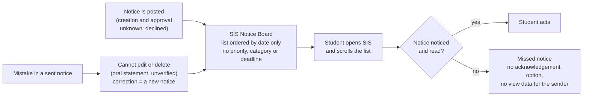
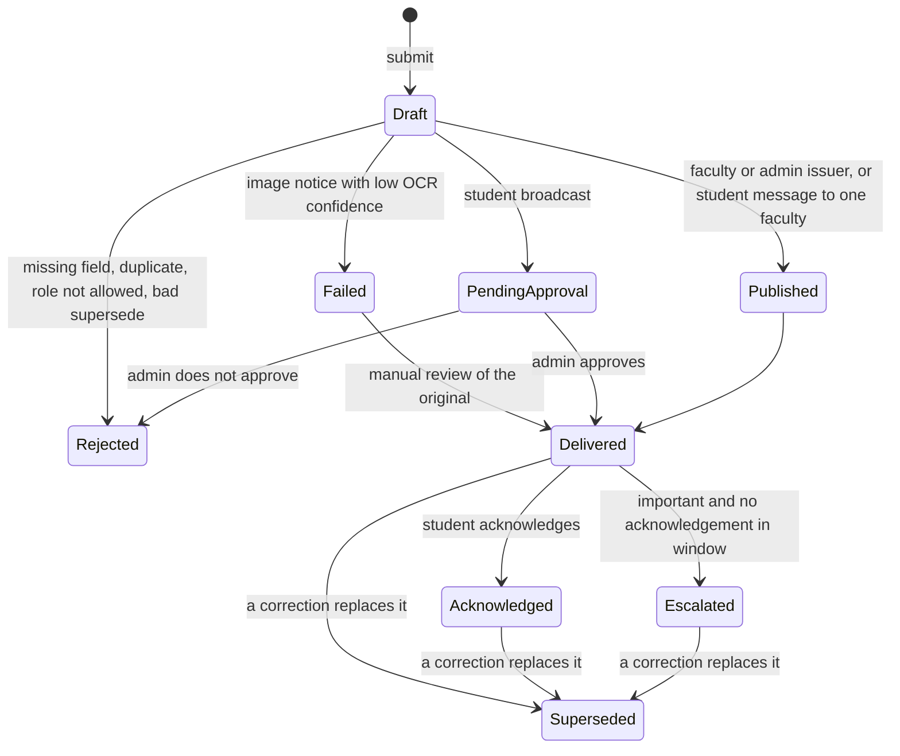

# Evidence-First Campus

**Evidence-first student work: every claim in this repo is tagged OBSERVED, ESTIMATE or ASSUMPTION, and every "built" claim has a test behind it.**

Round 2 submission, B.Tech Data Science and AI, ICFAI Tech, Hyderabad. This is student work, not an official syllabus revision and not an official college system.

[](https://github.com/vrushalishrianantsavant23-cmyk/Evidence-First-Campus/actions/workflows/tests.yml)

> Release and commit links: see the "Release" section at the end of this file.

## What this repo contains

| Task | What I did | Folder |
|------|-----------|--------|
| Task 1 | Studied how a notice reaches students through the SIS Notice Board, mapped it, proposed an improved process, tested it with 5 synthetic cases, and modelled net time saved | [`task1/`](task1/) |
| Task 2 | Audited my programme's credits by semester, proposed KEEP / UPDATE / REDUCE / ADD changes backed by 3 dated job descriptions, checked 5 AI-assisted exercises, turned Task 1 into a capstone proposal, and built a credit calculator | [`task2/`](task2/) |

## Headline numbers (each one I checked myself)

| Number | Meaning | Where |
|--------|---------|-------|
| 8 passed | 8 pytest tests of the notice-rule simulator, GitHub Actions run #14, commit 550f446, 24 Oct 2026, Python 3.12.15 | [`task1/test-results.md`](task1/test-results.md) |
| 36 / 166 = 21.7% | Changed credits (UPDATE + REDUCE) over programme total, inside the 20 to 25% band; the total stays 166 | [`task2/report.md`](task2/report.md) |
| 12 of 23 | In a small sample of 23 notices in my own SIS account, 12 were not marked viewed (95% Wilson interval about 33 to 71%). One student, not random: NOT scaled to the 809 notices | [`task1/evidence-log.md`](task1/evidence-log.md) |
| 3 to 5 per week | Estimated notices posted per week (recent about 3.0, overall about 4.8), from dates on the board | [`task1/evidence-log.md`](task1/evidence-log.md) |
| -0.345 / 0.84 / 2.25 | Net minutes saved per student per week (low / base / high). A model with no measured data, cohort of 100 assumed; negative in the low scenario | [`task1/net-time-saved.md`](task1/net-time-saved.md) |

## How this maps to the six assessment criteria

| Criterion | Where to look |
|-----------|---------------|
| Problem understanding | [`task1/evidence-log.md`](task1/evidence-log.md), [`task1/process-map.md`](task1/process-map.md), [`task1/report.md`](task1/report.md) |
| Personal contribution | Section "Personal contribution" below |
| Sources | Section "Sources and access dates" below, plus the evidence log (E1 to E18) |
| AI-output verification | [`task2/ai-use/ai-use-record.md`](task2/ai-use/ai-use-record.md), section "AI use" below |
| Practical design | [`task1/improved-process.md`](task1/improved-process.md), [`task1/simulator/`](task1/simulator/), capstone in [`task2/report.md`](task2/report.md) section 8 |
| Honest limitations | Section "Limitations" below |

## Task 1: the problem (current process)

Only what I saw or was told is drawn. How notices are created and approved is NOT drawn: the official I asked declined to explain it and I did not press.



Board facts (OBSERVED in my own account, 24 Oct 2026): "Showing the latest 100 of 809 notices", oldest notice dated 6 Aug 2023. The viewed tick or cross is my own account only.

## Task 1: the improved process (a status engine)

[`task1/simulator/notice_engine.py`](task1/simulator/notice_engine.py) is a small Python model of the improved process. **All data used with it is synthetic.** It is a simulator, not a college system and not connected to the SIS.



| Rule | What the code does | Result |
|------|--------------------|--------|
| Required fields | `title`, `body`, `audience` must not be empty | `Rejected`, "missing: ..." |
| Duplicate | Same title, body, audience as an earlier notice that is not Rejected or Failed | `Rejected`, "duplicate of notice N" |
| Failed step | Image notice with OCR confidence below 0.6 (synthetic number) | `Failed`; `manual_review` can deliver it |
| Who may broadcast | Only `faculty` and `admin` | others: `Rejected`, "role not allowed" |
| Approval boundary | A student broadcast needs an admin decision | `PendingApproval`, then `Delivered` or `Rejected` |
| Two-way messaging | A student message to one faculty (`audience` starts with `one:`) needs no approval | `Delivered` |
| Corrections | Sent notices are not edited; a correction is a new notice | old notice `Superseded` |
| Acknowledgement privacy | The sender sees only `ack_count`, never who acknowledged | by design |
| Escalation | Important notice with no acknowledgement | `Escalated` |

What the simulator does NOT do: it does not read images (OCR is only a confidence number passed in by the test), it does not know who is logged in (the role is a parameter), and it stores nothing between runs.

## Task 1: the five required synthetic cases

All inputs are synthetic (`student_a`, `faculty_x` are made-up labels). Source: [`test_notice_engine.py`](task1/simulator/test_notice_engine.py).

| # | Case | Test | Synthetic input | Expected result (asserted) | Recovery (asserted) |
|---|------|------|-----------------|----------------------------|---------------------|
| 1 | Normal | `test_1_normal` | Faculty posts "Exam schedule", audience `sem7`, important | `Delivered`; after acknowledgement `Acknowledged` | none needed |
| 2 | Missing information | `test_2_missing_information` | Faculty posts with an empty title | `Rejected`, reason contains "title" | Resubmit with a title: `Delivered` |
| 3 | Duplicate | `test_3_duplicate` | Admin posts the same notice twice | 1st `Delivered`; 2nd `Rejected`, "duplicate of notice 1" | First notice stays live |
| 4 | Unauthorized request | `test_4_unauthorized_request` | Student tries to broadcast "Sell books" to `all` | `PendingApproval`; admin declines: `Rejected` | Message to ONE faculty (`one:faculty_x`): `Delivered` |
| 5 | Failed step | `test_5_failed_step` | Admin posts a scanned notice, synthetic OCR confidence 0.3 | `Failed`, "check original notice" | `manual_review` with typed text: `Delivered` |

Three more tests: `test_escalation_of_unacknowledged_important_notice` (becomes `Escalated`), `test_7_correction_supersedes_old_notice` (old notice `Superseded`; superseding id 99 is `Rejected`), `test_8_ack_count_does_not_double_count` (same student twice counts once).

Recorded run: workflow "tests", run #14, commit 550f446, 24 Oct 2026, "collected 8 items", "8 passed in 0.02s" (Python 3.12.15, pytest 9.1.1). [Run page](https://github.com/vrushalishrianantsavant23-cmyk/Evidence-First-Campus/actions/runs/40079556691)

Not covered by tests: an unknown role (code returns `Rejected`, but untested); escalation has no clock; `manual_review` has no permission check; everything is in memory and synthetic, never run against the real SIS.

Run it yourself:

```bash
git clone https://github.com/vrushalishrianantsavant23-cmyk/Evidence-First-Campus.git
cd Evidence-First-Campus
pip install pytest
pytest -v task1/simulator
```

Expected: 8 tests collected, 8 passed. The same command runs on every push via [`.github/workflows/tests.yml`](.github/workflows/tests.yml).
