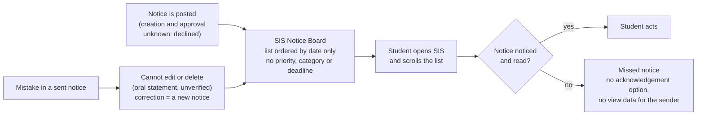
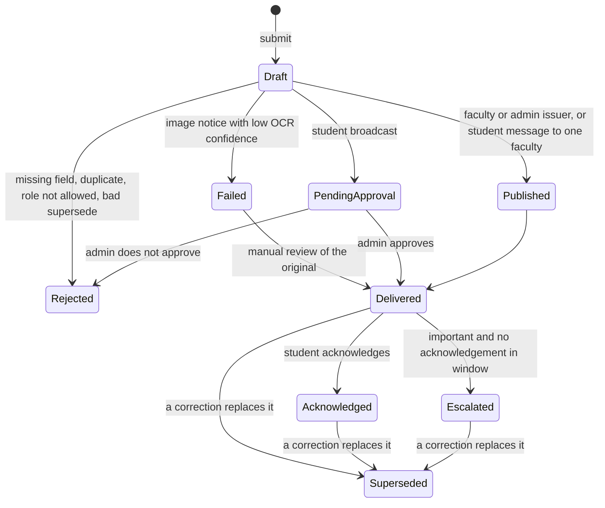

# Evidence-First Campus

**Evidence-first student work: every claim in this repo is tagged OBSERVED, ESTIMATE or ASSUMPTION, and every "built" claim has a test behind it.**

Round 2 submission, B.Tech Data Science and AI, ICFAI Tech, Hyderabad. This is student work, not an official syllabus revision and not an official college system.

[](https://github.com/vrushalishrianantsavant23-cmyk/Evidence-First-Campus/actions/workflows/tests.yml)

> Release: [v1.0](https://github.com/vrushalishrianantsavant23-cmyk/Evidence-First-Campus/releases/tag/v1.0) | Full commit: [abb6f7196cec55592ff69bd1b6e97465bea23178](https://github.com/vrushalishrianantsavant23-cmyk/Evidence-First-Campus/commit/abb6f7196cec55592ff69bd1b6e97465bea23178)

## What this repo contains

| Task | What I did | Folder |
|------|-----------|--------|
| Task 1 | Studied how a notice reaches students through the SIS Notice Board, mapped it, proposed an improved process, tested it with 5 synthetic cases, and modelled net time saved | [`task1/`](task1/) |
| Task 2 | Audited my programme's credits by semester, proposed KEEP / UPDATE / REDUCE / ADD changes backed by 3 dated job descriptions, checked 5 AI-assisted exercises, turned Task 1 into a capstone proposal, and built a credit calculator | [`task2/`](task2/) |

## Headline numbers (each one I checked myself)

| Number | Meaning | Where |
|--------|---------|-------|
| 8 passed | 8 pytest tests of the notice-rule simulator, GitHub Actions run #14, commit 550f446, 24 Oct 2026, Python 3.12.15 | [`task1/test-results.md`](task1/test-results.md) |
| 36 / 166 = 21.7% | Changed credits (UPDATE + REDUCE) over programme total, inside the 20 to 25% band; the total stays 166 | [`task2/report.md`](task2/report.md) |
| 12 of 23 | In a small sample of 23 notices in my own SIS account, 12 were not marked viewed (95% Wilson interval about 33 to 71%). One student, not random: NOT scaled to the 809 notices | [`task1/evidence-log.md`](task1/evidence-log.md) |
| 3 to 5 per week | Estimated notices posted per week (recent about 3.0, overall about 4.8), from dates on the board | [`task1/evidence-log.md`](task1/evidence-log.md) |
| -0.345 / 0.84 / 2.25 | Net minutes saved per student per week (low / base / high). A model with no measured data, cohort of 100 assumed; negative in the low scenario | [`task1/net-time-saved.md`](task1/net-time-saved.md) |

## How this maps to the six assessment criteria

| Criterion | Where to look |
|-----------|---------------|
| Problem understanding | [`task1/evidence-log.md`](task1/evidence-log.md), [`task1/process-map.md`](task1/process-map.md), [`task1/report.md`](task1/report.md) |
| Personal contribution | Section "Personal contribution" below |
| Sources | Section "Sources and access dates" below, plus the evidence log (E1 to E18) |
| AI-output verification | [`task2/ai-use/ai-use-record.md`](task2/ai-use/ai-use-record.md), section "AI use" below |
| Practical design | [`task1/improved-process.md`](task1/improved-process.md), [`task1/simulator/`](task1/simulator/), capstone in [`task2/report.md`](task2/report.md) section 8 |
| Honest limitations | Section "Limitations" below |

## Task 1: the problem (current process)

Only what I saw or was told is drawn. How notices are created and approved is NOT drawn: the official I asked declined to explain it and I did not press.



Board facts (OBSERVED in my own account, 24 Oct 2026): "Showing the latest 100 of 809 notices", oldest notice dated 6 Aug 2023. The viewed tick or cross is my own account only.

## Task 1: the improved process (a status engine)

[`task1/simulator/notice_engine.py`](task1/simulator/notice_engine.py) is a small Python model of the improved process. **All data used with it is synthetic.** It is a simulator, not a college system and not connected to the SIS.



| Rule | What the code does | Result |
|------|--------------------|--------|
| Required fields | `title`, `body`, `audience` must not be empty | `Rejected`, "missing: ..." |
| Duplicate | Same title, body, audience as an earlier notice that is not Rejected or Failed | `Rejected`, "duplicate of notice N" |
| Failed step | Image notice with OCR confidence below 0.6 (synthetic number) | `Failed`; `manual_review` can deliver it |
| Who may broadcast | Only `faculty` and `admin` | others: `Rejected`, "role not allowed" |
| Approval boundary | A student broadcast needs an admin decision | `PendingApproval`, then `Delivered` or `Rejected` |
| Two-way messaging | A student message to one faculty (`audience` starts with `one:`) needs no approval | `Delivered` |
| Corrections | Sent notices are not edited; a correction is a new notice | old notice `Superseded` |
| Acknowledgement privacy | The sender sees only `ack_count`, never who acknowledged | by design |
| Escalation | Important notice with no acknowledgement | `Escalated` |

What the simulator does NOT do: it does not read images (OCR is only a confidence number passed in by the test), it does not know who is logged in (the role is a parameter), and it stores nothing between runs.

## Task 1: the five required synthetic cases

All inputs are synthetic (`student_a`, `faculty_x` are made-up labels). Source: [`test_notice_engine.py`](task1/simulator/test_notice_engine.py).

| # | Case | Test | Synthetic input | Expected result (asserted) | Recovery (asserted) |
|---|------|------|-----------------|----------------------------|---------------------|
| 1 | Normal | `test_1_normal` | Faculty posts "Exam schedule", audience `sem7`, important | `Delivered`; after acknowledgement `Acknowledged` | none needed |
| 2 | Missing information | `test_2_missing_information` | Faculty posts with an empty title | `Rejected`, reason contains "title" | Resubmit with a title: `Delivered` |
| 3 | Duplicate | `test_3_duplicate` | Admin posts the same notice twice | 1st `Delivered`; 2nd `Rejected`, "duplicate of notice 1" | First notice stays live |
| 4 | Unauthorized request | `test_4_unauthorized_request` | Student tries to broadcast "Sell books" to `all` | `PendingApproval`; admin declines: `Rejected` | Message to ONE faculty (`one:faculty_x`): `Delivered` |
| 5 | Failed step | `test_5_failed_step` | Admin posts a scanned notice, synthetic OCR confidence 0.3 | `Failed`, "check original notice" | `manual_review` with typed text: `Delivered` |

Three more tests: `test_escalation_of_unacknowledged_important_notice` (becomes `Escalated`), `test_7_correction_supersedes_old_notice` (old notice `Superseded`; superseding id 99 is `Rejected`), `test_8_ack_count_does_not_double_count` (same student twice counts once).

Recorded run: workflow "tests", run #14, commit 550f446, 24 Oct 2026, "collected 8 items", "8 passed in 0.02s" (Python 3.12.15, pytest 9.1.1). [Run page](https://github.com/vrushalishrianantsavant23-cmyk/Evidence-First-Campus/actions/runs/40079556691)

Not covered by tests: an unknown role (code returns `Rejected`, but untested); escalation has no clock; `manual_review` has no permission check; everything is in memory and synthetic, never run against the real SIS.

Run it yourself:

```bash
git clone https://github.com/vrushalishrianantsavant23-cmyk/Evidence-First-Campus.git
cd Evidence-First-Campus
pip install pytest
pytest -v task1/simulator
```

Expected: 8 tests collected, 8 passed. The same command runs on every push via [`.github/workflows/tests.yml`](.github/workflows/tests.yml).

## Task 2: curriculum audit and proposal

Full report: [`task2/report.md`](task2/report.md). Data: [`task2/data/`](task2/data/). Credits come from the college SIS (I read it myself); no grades are used. I did not read a separate regulations document.

| Semester | Credits | Courses changed in the proposal |
|----------|--------:|---------------------------------|
| I | 20 | none |
| II | 24 | none |
| III | 24 | CS206 |
| IV | 24 | CS205, DS202 |
| V | 21 | DS303 (reduce), DS305, CS415 |
| VI | 19 | ML302 (reduce), DS307, SP301 |
| VII | 16 | CS307, DS408 |
| I to VII | 148 | |
| IP-I (summer) | 3 | none |
| IP-II (Sem VIII, my plan, not yet registered) | 15 | none |
| **Total** | **166** | |

| Action | Courses | Credits |
|--------|---------|--------:|
| REDUCE | DS303 Blockchain, ML302 Fuzzy and Rough Set | 6 |
| ADD (same slot) | NEW1 AI Evaluation, Testing and Observability replaces DS303; NEW2 MLOps and Deployment replaces ML302 | 6 |
| UPDATE | CS206, DS305, DS307, CS205, DS202, CS415, SP301, CS307, DS408 | 30 |
| KEEP | everything else | 130 |

Counting rule (ASSUMPTION): changed = UPDATE + REDUCE = 30 + 6 = 36; 36 / 166 = 21.7%. Other rules give 7.2% (REDUCE and ADD only) to 25.3% (everything counted separately). Every semester total stays the same, so the total stays 166.

Job descriptions (all accessed 23 Oct 2026):

| ID | Role | Company | Posted | Link |
|----|------|---------|--------|------|
| JD1 | AI Engineer, Enterprise Conversational Platform | HiringBlaze (likely an intermediary) | 2026-10-14 | [link](https://www.hirist.tech/j/ai-engineer-enterprise-conversational-platform-1678232) |
| JD2 | Junior Data Engineer | Crowe, Hyderabad | 2026-10-22 | [link](https://crowe.wd12.myworkdayjobs.com/en-US/external_careers/job/Hyderabad-Telangana-India/Junior-Data-Engineer_R-51712-1) |
| JD3 | GenAI Engineer (contract) | Workiy, remote | opened 2026-09-29 | [link](https://workiy.zohorecruit.com/jobs/Workiy-Careers/574222000024500104) |

Three job posts are a small sample: a pattern, not the job market.

**Credit calculator (interactive tool):** [open it](https://vrushalishrianantsavant23-cmyk.github.io/Evidence-First-Campus/task2/calculator/). My own check in my browser on 24 Oct 2026: 166, 166, Balanced Yes, 36 changed credits, 21.7%, inside 20 to 25% Yes.

**Capstone from Task 1:** SP301 Special Project becomes a "Workflow Reliability" capstone: students map a small workflow, keep a dated evidence log, build a status engine, test five synthetic cases on GitHub Actions, and model net time saved. It is a proposal; I do not know what SP301 contains today. Details: [`task2/report.md`](task2/report.md) section 8.

**Feedback:** I received 1 voluntary written comment (WhatsApp message, 24 Oct 2026) from a faculty in-charge (role only, no name). It was about the calculator, not the full report, and the person was not independently verified. She found the semester-wise before and after credits and the calculations clear, and suggested a short explanation of ADD, UPDATE and REDUCE; I have not added that yet. No graduate feedback was received. Details: [`task2/report.md`](task2/report.md) section 9.

## AI use

All five exercises used Claude Sonnet 5.5 on 23 Oct 2026. The checking code was written with Claude's help; I ran it and compared the results myself. Full record: [`task2/ai-use/ai-use-record.md`](task2/ai-use/ai-use-record.md).

| # | Subject | Exercise | How I verified | Result |
|---|---------|----------|----------------|--------|
| 1 | Computer Networks | Split 192.168.10.0/24 into /27 subnets | Python `ipaddress`; checked by hand that 3 borrowed bits are needed | Correct |
| 2 | DBMS | Normalize an Orders table to 3NF | Ran the SQL in SQLite Online; checked each dependency by hand | Correct (first run failed because I ran it twice; fixed with DROP TABLE IF EXISTS) |
| 3 | Algorithms | T(n) = 3T(n/2) + n^2, Master theorem | Python recursion; checked case 3 by hand | Correct: Theta(n^2) |
| 4 | Operating Systems | SRTF and Round Robin (q = 3) waiting times | Python simulation | Correct: 6.5 and 13.5 |
| 5 | Deep Learning | Gradients of one sigmoid neuron with MSE | Central-difference numerical check | Correct for the 1/2 convention |

## Personal contribution

| What I did myself | What Claude drafted (and I reviewed) |
|-------------------|--------------------------------------|
| Read my own SIS Notice Board and recorded counts and dates (E1 to E18) | Wording of reports and tables |
| Read my own credits in the SIS and entered them in `courses.csv` | Structure of the proposal files and the calculator code |
| Found and chose the three real job descriptions | Mermaid diagrams and the simulator code |
| Ran the tests on GitHub Actions and the calculator in my own browser | Checking code for the five AI exercises |
| Decided what is built and what is not (placement portal, OCR, chatbot are NOT built) | |
| Corrected errors found during review | |

## Sources and access dates

| Source | Used for | Accessed |
|--------|----------|----------|
| College SIS Notice Board (my own login) | Notice counts and dates, Task 1 | 23 and 24 Oct 2026 |
| College SIS (my own login) | Course credits, Task 2 | 23 Oct 2026 |
| Elective timetable and basket list given to me by the college (not republished) | Checking Sem VII elective credits | date not recorded |
| https://ifheindia.org/icfai-tech-school-hyderabad/icfaitech-internship | Internship rules | 23 Oct 2026 |
| https://ifheindia.org/lp/icfaitech2025 | Internship rules | 23 Oct 2026 |
| JD1, JD2, JD3 (links above) | Job description comparison | 23 Oct 2026 |

Oral statements from a senior academic official (role only, no name) are unverified. No written permission was received.

## Limitations (all in one place)

- No written permission. Task 1 uses only my own SIS account, oral statements and synthetic data. The official declined to explain how notices are created and approved, so that part is not mapped.
- The 12 of 23 sample is one student and not random; it is not scaled to 809 notices.
- Net-time-saved numbers are a model with no measured data; the low scenario is negative.
- The simulator is in-memory and synthetic. OCR is only a confidence number; no image is read. Escalation has no clock.
- 9 of the 11 changed courses were not checked against their syllabus; only ML302 and DS408 were.
- Credits come from the college SIS, not a separate regulations document. IP-II is my planned internship. The website and my transcript disagree on when IP-I happens.
- Three job descriptions are a weak basis, and absence from three posts is weak evidence for REDUCE. JD3 does not state experience.
- CS415 shows "Only CSE" in a timetable I saw although it is on my transcript: unresolved.
- The counting rule for changed credits is my assumption.
- The capstone is a proposal, not tried with students.
- Feedback is a single written comment from one faculty in-charge, on the calculator only; no graduate feedback was received.
- Each AI check used one example per subject.

## Future work (suggested orally, NOT built)

A senior academic official verbally suggested these. None is built or investigated: campus placement portal, OCR of notices into a dashboard, personalised chatbot. Only the two-way messaging rule exists (inside the simulator, tested by test 4). Elective registration reminders: an idea, not investigated.

## Release

Release and full commit URL: to be added in the last commit.
