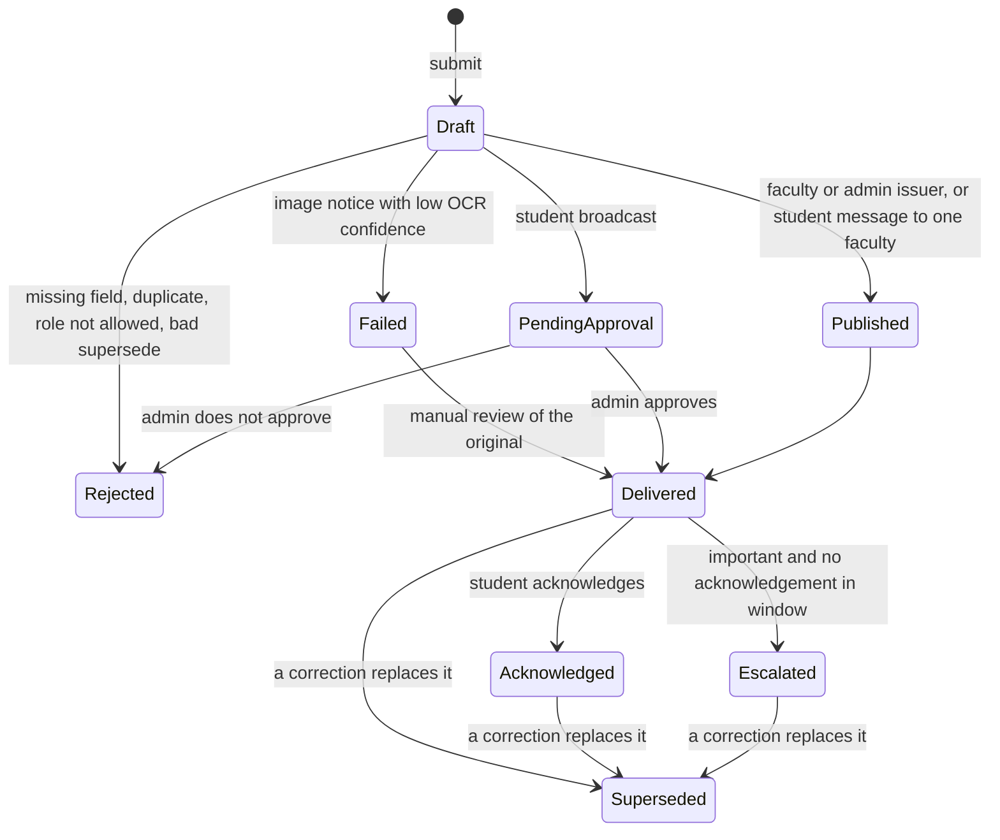

# Evidence-First-Campus
Evidence-first audit of a campus notice workflow and curriculum
## Tests status

[](https://github.com/vrushalishrianantsavant23-cmyk/Evidence-First-Campus/actions/workflows/tests.yml)

Recorded run: workflow "tests", run #14, commit 550f446, 24 Oct 2026, "collected 8 items", "8 passed in 0.02s" (Python 3.12.15, pytest 9.1.1). [Run page](https://github.com/vrushalishrianantsavant23-cmyk/Evidence-First-Campus/actions/runs/40079556691)

## The improved process: a status engine

The notice engine in [`task1/simulator/notice_engine.py`](task1/simulator/notice_engine.py) is a small Python model of the improved process. **All data used with it is synthetic.** It is a simulator, not a college system and not connected to the SIS.

Statuses in the code: `Draft`, `PendingApproval`, `Published`, `Delivered`, `Acknowledged`, `Escalated`, `Superseded`, `Rejected`, `Failed`.



### Rules, as written in the code

| Rule | What the code does | Status result |
|------|--------------------|---------------|
| Required fields | `title`, `body` and `audience` must not be empty | `Rejected`, reason "missing: ..." |
| Duplicate | Same title, body and audience as an earlier notice that is not Rejected or Failed | `Rejected`, reason "duplicate of notice N" |
| Failed step | Image notice with OCR confidence below 0.6 (the number is synthetic) | `Failed`, "check original notice"; `manual_review` can then deliver it |
| Who may broadcast | Only `faculty` and `admin` issuers | other roles: `Rejected`, "role not allowed" |
| Approval boundary | A student broadcast needs an admin decision | `PendingApproval`, then `Delivered` or `Rejected` |
| Two-way messaging | A student message addressed to one faculty (`audience` starts with `one:`) needs no approval | `Delivered` |
| Corrections | Sent notices are not edited; a correction is a new notice that marks the old one | old notice `Superseded` |
| Privacy of acknowledgements | The sender sees only `ack_count`, never who acknowledged | by design |
| Escalation | An important notice with no acknowledgement | `Escalated` |

The exact test cases and their results are in [`task1/test-results.md`](task1/test-results.md).

### A real excerpt (the validation steps, unchanged from the file)

```python
n = self._new(issuer, title, body, audience, important)

missing = [f for f in REQUIRED_FIELDS if not getattr(n, f).strip()]
if missing:
    n.status, n.reason = "Rejected", "missing: " + ", ".join(missing)
    return n

for other in self.notices[:-1]:
    if (other.status not in ("Rejected", "Failed")
            and (other.title, other.body, other.audience)
            == (n.title, n.body, n.audience)):
        n.status, n.reason = "Rejected", f"duplicate of notice {other.id}"
        return n

if ocr_confidence is not None and ocr_confidence < OCR_MIN_CONFIDENCE:
    n.status, n.reason = "Failed", "check original notice"
    return n
```

### What the simulator does NOT do

- It does not read images. OCR is only a confidence number passed in by the test.
- It does not know who is logged in; the issuer role is a parameter.
- It does not store anything between runs.
