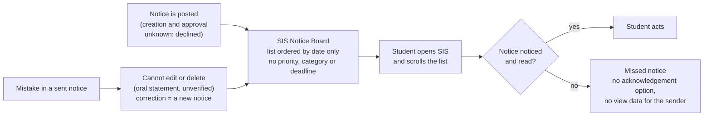
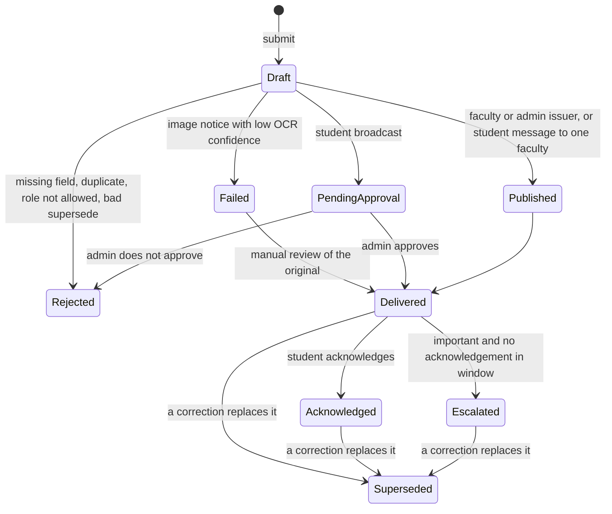

# Evidence-First Campus

**Evidence-first student work: every claim in this repo is tagged OBSERVED, ESTIMATE or ASSUMPTION, and every "built" claim has a test behind it.**

Round 2 submission, B.Tech Data Science and AI, ICFAI Tech, Hyderabad. This is student work, not an official syllabus revision and not an official college system.

> Release and commit links: added in the last commit (see the end of this file).

[](https://github.com/vrushalishrianantsavant23-cmyk/Evidence-First-Campus/actions/workflows/tests.yml)

## What this repo contains

| Task | What I did | Folder |
|------|-----------|--------|
| Task 1 | Studied how a notice reaches students through the SIS Notice Board, mapped it, proposed an improved process, tested it with 5 synthetic cases, and modelled net time saved | [`task1/`](task1/) |
| Task 2 | Audited my programme's credits by semester, proposed KEEP / UPDATE / REDUCE / ADD changes backed by 3 dated job descriptions, checked 5 AI-assisted exercises, turned Task 1 into a capstone proposal, and built a credit calculator | [`task2/`](task2/) |

## Headline numbers (each one I checked myself)

| Number | Meaning | Where |
|--------|---------|-------|
| 8 passed | 8 pytest tests of the notice-rule simulator, GitHub Actions run #14, commit 550f446, 24 Oct 2026, Python 3.12.15 | [`task1/test-results.md`](task1/test-results.md) |
| 36 / 166 = 21.7% | Changed credits (UPDATE + REDUCE) over programme total, inside the 20 to 25% band; the total stays 166 | [`task2/report.md`](task2/report.md) |
| 12 of 23 | In a small sample of 23 notices in my own SIS account, 12 were not marked viewed (95% Wilson interval about 33 to 71%). One student, not random: it is NOT scaled to the 809 notices | [`task1/evidence-log.md`](task1/evidence-log.md) |
| 3 to 5 per week | Estimated notices posted per week (recent about 3.0, overall about 4.8), from dates on the board | [`task1/evidence-log.md`](task1/evidence-log.md) |
| -0.345 / 0.84 / 2.25 | Net minutes saved per student per week (low / base / high). A model with no measured data, cohort of 100 assumed; negative in the low scenario | [`task1/net-time-saved.md`](task1/net-time-saved.md) |

## How this maps to the six assessment criteria

| Criterion | Where to look |
|-----------|---------------|
| Problem understanding | [`task1/evidence-log.md`](task1/evidence-log.md), [`task1/process-map.md`](task1/process-map.md), [`task1/report.md`](task1/report.md) |
| Personal contribution | Section "Personal contribution" below |
| Sources | Section "Sources and access dates" below, plus the evidence log (E1 to E18) |
| AI-output verification | [`task2/ai-use/ai-use-record.md`](task2/ai-use/ai-use-record.md), section "AI use" below |
| Practical design | [`task1/improved-process.md`](task1/improved-process.md), [`task1/simulator/`](task1/simulator/), the capstone in [`task2/report.md`](task2/report.md) section 8 |
| Honest limitations | Section "Limitations" below (all in one place) |

## Task 1: the problem (current process)

Only what I saw or was told is drawn. How notices are created and approved is NOT drawn, because the official I asked declined to explain it and I did not press.



Board facts (OBSERVED in my own account, 24 Oct 2026): "Showing the latest 100 of 809 notices", oldest notice dated 6 Aug 2023. The viewed tick or cross is my own account only.

## Task 1: the improved process (a status engine)

The notice engine in [`task1/simulator/notice_engine.py`](task1/simulator/notice_engine.py) is a small Python model of the improved process. **All data used with it is synthetic.** It is a simulator, not a college system and not connected to the SIS.

Statuses in the code: `Draft`, `PendingApproval`, `Published`, `Delivered`, `Acknowledged`, `Escalated`, `Superseded`, `Rejected`, `Failed`.



### Rules, as written in the code

| Rule | What the code does | Status result |
|------|--------------------|---------------|
| Required fields | `title`, `body` and `audience` must not be empty | `Rejected`, reason "missing: ..." |
| Duplicate | Same title, body and audience as an earlier notice that is not Rejected or Failed | `Rejected`, reason "duplicate of notice N" |
| Failed step | Image notice with OCR confidence below 0.6 (the number is synthetic) | `Failed`, "check original notice"; `manual_review` can then deliver it |
| Who may broadcast | Only `faculty` and `admin` issuers | other roles: `Rejected`, "role not allowed" |
| Approval boundary | A student broadcast needs an admin decision | `PendingApproval`, then `Delivered` or `Rejected` |
| Two-way messaging | A student message addressed to one faculty (`audience` starts with `one:`) needs no approval | `Delivered` |
| Corrections | Sent notices are not edited; a correction is a new notice that marks the old one | old notice `Superseded` |
| Privacy of acknowledgements | The sender sees only `ack_count`, never who acknowledged | by design |
| Escalation | An important notice with no acknowledgement | `Escalated` |

### A real excerpt (the validation steps, unchanged from the file)

```python
n = self._new(issuer, title, body, audience, important)

missing = [f for f in REQUIRED_FIELDS if not getattr(n, f).strip()]
if missing:
    n.status, n.reason = "Rejected", "missing: " + ", ".join(missing)
    return n

for other in self.notices[:-1]:
    if (other.status not in ("Rejected", "Failed")
            and (other.title, other.body, other.audience)
            == (n.title, n.body, n.audience)):
        n.status, n.reason = "Rejected", f"duplicate of notice {other.id}"
        return n

if ocr_confidence is not None and ocr_confidence < OCR_MIN_CONFIDENCE:
    n.status, n.reason = "Failed", "check original notice"
    return n
```

### What the simulator does NOT do

- It does not read images. OCR is only a confidence number passed in by the test.
- It does not know who is logged in; the issuer role is a parameter.
- It does not store anything between runs.

## Task 1: the five required synthetic cases

All inputs are synthetic (`student_a` and `faculty_x` are made-up labels, not real people). Source: [`task1/simulator/test_notice_engine.py`](task1/simulator/test_notice_engine.py).

| # | Case | Test | Synthetic input | Expected result (asserted) | Recovery (asserted) |
|---|------|------|-----------------|----------------------------|---------------------|
| 1 | Normal | `test_1_normal` | Faculty posts "Exam schedule", audience `sem7`, important | `Delivered`; after a student acknowledges: `Acknowledged` | none needed |
| 2 | Missing information | `test_2_missing_information` | Faculty posts with an empty title | `Rejected`, reason contains "title" | Resubmit with a title: `Delivered` |
| 3 | Duplicate | `test_3_duplicate` | Admin posts the same title, body and audience twice | 1st `Delivered`; 2nd `Rejected`, reason "duplicate of notice 1" | The first notice stays live |
| 4 | Unauthorized request | `test_4_unauthorized_request` | Student tries to broadcast "Sell books" to `all` | `PendingApproval`; after the admin declines: `Rejected` | A message to ONE faculty (`one:faculty_x`) needs no approval: `Delivered` |
| 5 | Failed step | `test_5_failed_step` | Admin posts a scanned notice with synthetic OCR confidence 0.3 | `Failed`, reason "check original notice" | `manual_review` with the typed text: `Delivered` |

Three more tests cover the rest of the design:

| Test | What it checks |
|------|----------------|
| `test_escalation_of_unacknowledged_important_notice` | An important notice with no acknowledgement becomes `Escalated` |
| `test_7_correction_supersedes_old_notice` | A correction marks the old notice `Superseded`; superseding a notice that does not exist (id 99) is `Rejected` |
| `test_8_ack_count_does_not_double_count` | The same student acknowledging twice counts once; two students give `ack_count == 2` |

Recorded run: workflow "tests", run #14, commit 550f446, 24 Oct 2026, "collected 8 items", "8 passed in 0.02s" (Python 3.12.15, pytest 9.1.1). [Run page](https://github.com/vrushalishrianantsavant23-cmyk/Evidence-First-Campus/actions/runs/40079556691)

### What the tests do NOT cover

- No test for an unknown role (for example a visitor). The code returns `Rejected`, "role not allowed", but I did not test it.
- Escalation has no clock. The test calls `escalate_if_unacknowledged` directly; the "window" is not modelled in code.
- `manual_review` has no permission check in the simulator. A real system would need one.
- Everything is in memory and synthetic. Nothing was run against the real SIS.

### Run it yourself

```bash
git clone https://github.com/vrushalishrianantsavant23-cmyk/Evidence-First-Campus.git
cd Evidence-First-Campus
pip install pytest
pytest -v task1/simulator
```

Expected: 8 tests collected, 8 passed. The same command runs on every push through [`.github/workflows/tests.yml`](.github/workflows/tests.yml).
## Task 2: curriculum audit and proposal

Full report: [`task2/report.md`](task2/report.md). Data: [`task2/data/`](task2/data/). Credits come from the college SIS (I read it myself); no grades are used anywhere. I did not read a separate regulations document.

### Credits by semester (as registered, first attempt)

| Semester | Credits | Courses changed in the proposal |
|----------|--------:|---------------------------------|
| I | 20 | none |
| II | 24 | none |
| III | 24 | CS206 |
| IV | 24 | CS205, DS202 |
| V | 21 | DS303 (reduce), DS305, CS415 |
| VI | 19 | ML302 (reduce), DS307, SP301 |
| VII | 16 | CS307, DS408 |
| I to VII | 148 | |
| IP-I (summer) | 3 | none |
| IP-II (Sem VIII, my plan, not yet registered) | 15 | none |
| **Total** | **166** | |

### The proposal in numbers

| Action | Courses | Credits |
|--------|---------|--------:|
| REDUCE | DS303 Blockchain, ML302 Fuzzy and Rough Set | 6 |
| ADD (same slot, same credits) | NEW1 AI Evaluation, Testing and Observability replaces DS303; NEW2 MLOps and Deployment replaces ML302 | 6 |
| UPDATE | CS206, DS305, DS307, CS205, DS202, CS415, SP301, CS307, DS408 | 30 |
| KEEP | everything else | 130 |

Counting rule (ASSUMPTION): changed = UPDATE + REDUCE = 30 + 6 = 36; 36 / 166 = 21.7%. Other counting rules give 7.2% (REDUCE and ADD only) to 25.3% (everything counted separately). Every semester total stays the same, so the programme total stays 166.

### Job descriptions used (all accessed 23 Oct 2026)

| ID | Role | Company | Posted | Link |
|----|------|---------|--------|------|
| JD1 | AI Engineer, Enterprise Conversational Platform | HiringBlaze (likely an intermediary) | 2026-10-14 | [link](https://www.hirist.tech/j/ai-engineer-enterprise-conversational-platform-1678232) |
| JD2 | Junior Data Engineer | Crowe, Hyderabad | 2026-10-22 | [link](https://crowe.wd12.myworkdayjobs.com/en-US/external_careers/job/Hyderabad-Telangana-India/Junior-Data-Engineer_R-51712-1) |
| JD3 | GenAI Engineer (contract) | Workiy, remote | opened 2026-09-29 | [link](https://workiy.zohorecruit.com/jobs/Workiy-Careers/574222000024500104) |

Three job posts are a small sample: a pattern, not the job market.

### Credit calculator (small interactive tool)

[Open the calculator](https://vrushalishrianantsavant23-cmyk.github.io/Evidence-First-Campus/task2/calculator/). Tick or untick any change and it shows the total before and after, whether it is balanced, and the changed share. My own check in my browser on 24 Oct 2026: 166, 166, Balanced Yes, 36 changed credits, 21.7%, inside 20 to 25% Yes.

### Capstone built from Task 1

SP301 Special Project becomes a "Workflow Reliability" capstone: students map a small workflow, keep a dated evidence log, build a status engine, test five synthetic cases on GitHub Actions, and model net time saved. My Task 1 is the worked example. It is a proposal; I do not know what SP301 contains today. Details: [`task2/report.md`](task2/report.md) section 8.

### Feedback

At the time of writing I have not received feedback from any faculty member, graduate or senior. I will not write feedback I did not receive.
## Task 2: curriculum audit and proposal

Full report: [`task2/report.md`](task2/report.md). Data: [`task2/data/`](task2/data/). Credits come from the college SIS (I read it myself); no grades are used anywhere. I did not read a separate regulations document.

### Credits by semester (as registered, first attempt)

| Semester | Credits | Courses changed in the proposal |
|----------|--------:|---------------------------------|
| I | 20 | none |
| II | 24 | none |
| III | 24 | CS206 |
| IV | 24 | CS205, DS202 |
| V | 21 | DS303 (reduce), DS305, CS415 |
| VI | 19 | ML302 (reduce), DS307, SP301 |
| VII | 16 | CS307, DS408 |
| I to VII | 148 | |
| IP-I (summer) | 3 | none |
| IP-II (Sem VIII, my plan, not yet registered) | 15 | none |
| **Total** | **166** | |

### The proposal in numbers

| Action | Courses | Credits |
|--------|---------|--------:|
| REDUCE | DS303 Blockchain, ML302 Fuzzy and Rough Set | 6 |
| ADD (same slot, same credits) | NEW1 AI Evaluation, Testing and Observability replaces DS303; NEW2 MLOps and Deployment replaces ML302 | 6 |
| UPDATE | CS206, DS305, DS307, CS205, DS202, CS415, SP301, CS307, DS408 | 30 |
| KEEP | everything else | 130 |

Counting rule (ASSUMPTION): changed = UPDATE + REDUCE = 30 + 6 = 36; 36 / 166 = 21.7%. Other counting rules give 7.2% (REDUCE and ADD only) to 25.3% (everything counted separately). Every semester total stays the same, so the programme total stays 166.

### Job descriptions used (all accessed 23 Oct 2026)

| ID | Role | Company | Posted | Link |
|----|------|---------|--------|------|
| JD1 | AI Engineer, Enterprise Conversational Platform | HiringBlaze (likely an intermediary) | 2026-10-14 | [link](https://www.hirist.tech/j/ai-engineer-enterprise-conversational-platform-1678232) |
| JD2 | Junior Data Engineer | Crowe, Hyderabad | 2026-10-22 | [link](https://crowe.wd12.myworkdayjobs.com/en-US/external_careers/job/Hyderabad-Telangana-India/Junior-Data-Engineer_R-51712-1) |
| JD3 | GenAI Engineer (contract) | Workiy, remote | opened 2026-09-29 | [link](https://workiy.zohorecruit.com/jobs/Workiy-Careers/574222000024500104) |

Three job posts are a small sample: a pattern, not the job market.

### Credit calculator (small interactive tool)

[Open the calculator](https://vrushalishrianantsavant23-cmyk.github.io/Evidence-First-Campus/task2/calculator/). Tick or untick any change and it shows the total before and after, whether it is balanced, and the changed share. My own check in my browser on 24 Oct 2026: 166, 166, Balanced Yes, 36 changed credits, 21.7%, inside 20 to 25% Yes.

### Capstone built from Task 1

SP301 Special Project becomes a "Workflow Reliability" capstone: students map a small workflow, keep a dated evidence log, build a status engine, test five synthetic cases on GitHub Actions, and model net time saved. My Task 1 is the worked example. It is a proposal; I do not know what SP301 contains today. Details: [`task2/report.md`](task2/report.md) section 8.

### Feedback

At the time of writing I have not received feedback from any faculty member, graduate or senior. I will not write feedback I did not receive.
