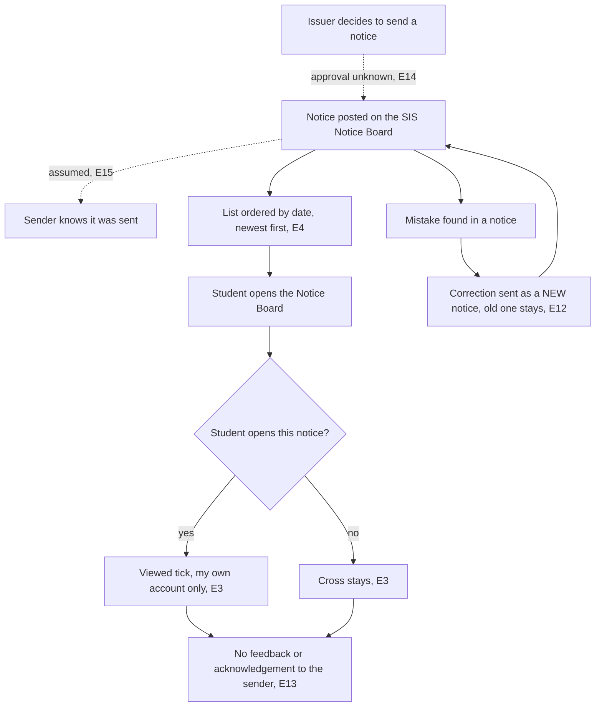

# Task 1 Process Map: how a notice reaches students (SIS Notice Board)

Legend: solid lines are things I saw on my own student login (OBSERVED) or things a senior academic official told me orally (not verified). Dotted lines are unknown or ASSUMPTION. Evidence IDs (E1 to E18) point to `evidence-log.md`.

## Steps, handoffs, approvals, exceptions

| # | Step | Handoff | Approval | Exception | Evidence |
|---|------|---------|----------|-----------|----------|
| 1 | Issuer decides to send a notice | issuer to SIS | UNKNOWN (the official declined to answer) | unknown | E14 (oral), E18 (assumption) |
| 2 | Notice is posted on the board | SIS to students | none seen | after sending it cannot be edited or deleted | E12 (oral) |
| 3 | Sender knows it was sent | none | none | not known | E15 (assumption) |
| 4 | Student sees a date-ordered list | SIS to student | none | no priority, category or deadline field | E4 (observed) |
| 5 | Student opens a notice | student | none | student never opens it (12 of 23 sampled rows had a cross on my account) | E9 (observed, one student, small sample) |
| 6 | Viewed tick or cross is shown | SIS to student | none | the mark is for my own account only | E3 (observed) |
| 7 | Feedback to sender | none | none | nobody sees who viewed; no acknowledgement option | E13 (oral) |
| 8 | Correction | issuer to SIS | unknown | correction goes out as a separate new notice | E12 (oral) |

## Gaps (what the current process does not give)

- No priority, category or deadline field (E4), so an urgent notice looks like any other.
- No view or acknowledgement information for the sender (E13).
- No way to correct a notice in place (E12), so the old wrong notice stays visible.
- Approval chain, who may issue notices, and any other channels (mail, WhatsApp, boards) are unknown to me (E14, E18).
- Everything here is from my view for SIS portal which we have plus oral statements given by our DEAN. It is not a verified map of the college process due to the permission restrictions and confidentiality.
