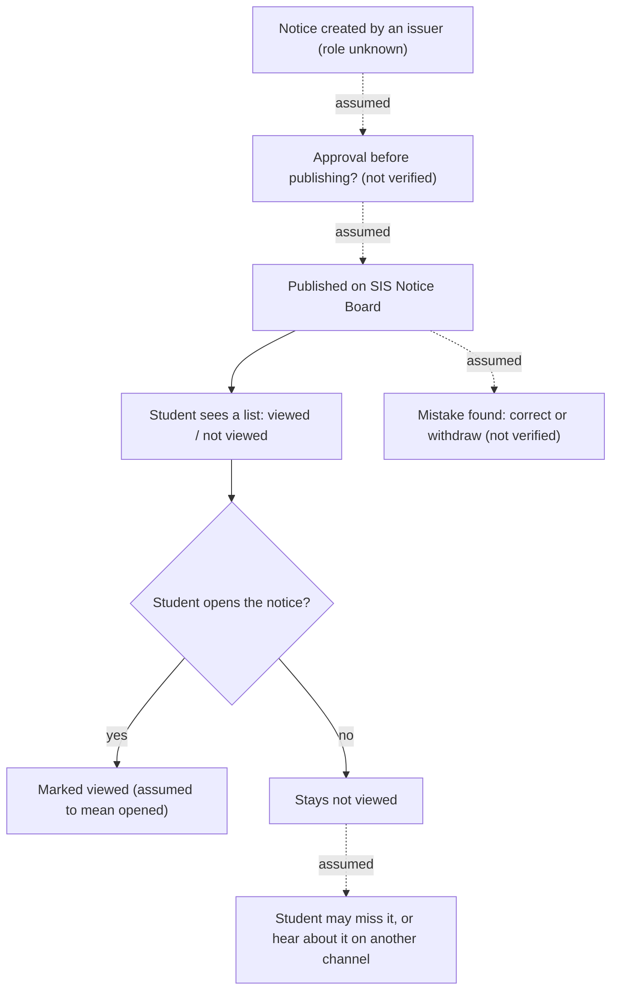

# Task 1 Process Map: Notice Board to Student

Legend: solid lines are [OBSERVED] in my own student SIS view. Dotted lines are [ASSUMPTION]; I did not get permission to study the inside of the process.

## Steps, handoffs, approvals, exceptions

| Step | Handoff | Approval | Exception | Tag |
|------|---------|----------|-----------|-----|
| Notice appears on the Notice Board | issuer to SIS to student | unknown | none seen | [OBSERVED] that it appears, [ASSUMPTION] for the rest |
| Student sees viewed / not viewed mark | SIS to student | none | 5 of the top 10 rows were not viewed on 2026-10-23 | [OBSERVED] |
| Student opens notice | student | none | student never opens it | [ASSUMPTION] |
| Mistake in a notice | issuer | unknown | withdraw or correct | [ASSUMPTION] |
| Student wants to reply or ask | no in-SIS reply seen | none | falls back to mail or other channels | [ASSUMPTION] |

## Problem (short)

- [OBSERVED] 808 notices in my view, and 5 of the top 10 were not viewed. A student must open notices one by one to find what matters.
- [ASSUMPTION] Important notices can get lost among many others, and replying needs a separate channel such as mail.
- Scale estimate will be added from the 50-row sample in `evidence-log.md`.
